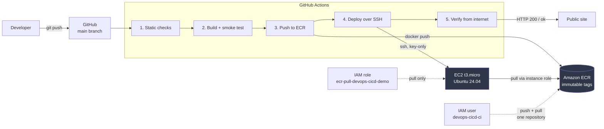

# Automated CI/CD Deployment Pipeline — AWS + Docker

A push to `main` builds a Docker image, tests it, publishes it to Amazon ECR, and
replaces the container running on EC2. No manual build, no manual deploy, no
credentials on the server.

**Live:** http://13.126.168.131 — health endpoint at `/healthz` returns `ok`.

The application is deliberately trivial (a static Nginx site). It exists to make
the pipeline observable: when the page changes, the deployment worked; when it
doesn't, something in the chain broke and there is exactly one place to look.

---

## Architecture



Two identities, both scoped to a single ECR repository. The server never holds a
key; it assumes a role. The CI user can push and read images, and nothing else.

---

## How a deploy works

1. You push to `main`.
2. **Static checks** — required files present, HTML tags balanced, health-endpoint
   contract intact. Fails in ~5s, before any AWS call.
3. **Build and smoke test** — image is built under a *local* tag, started, and
   every route the site depends on is fetched. A broken image never reaches ECR.
4. **Push** — retagged with the **full commit SHA** and pushed to ECR. Tags are
   immutable, so an image can never be silently overwritten.
5. **Deploy** — SSH to EC2, authenticate to ECR using the *instance role*, pull,
   remove the old container, start the new one.
6. **Verify** — health endpoint checked locally, then again **from the public
   internet**, because a local check cannot detect a broken security group.

A `guard` job fails the run if the deploy job did not actually succeed — GitHub
otherwise reports a skipped job as a green run.

**If the new container never becomes healthy, the deploy puts the previous image
back before exiting.** The run still fails — a rollback is a recovery, not a
pass — but the site stays up while somebody reads the log.

Typical end-to-end time: **40–55 seconds**.

---

## Rollback

Rolling back is a dropdown, not an SSH session.

**Actions → Build, Test and Deploy → Run workflow → `image_tag` = `<commit SHA>`**

The run pulls that exact published image, smoke tests it with the same script a
normal deploy uses, and replaces the container. No rebuild, no source revert.

Because images are tagged by commit and never overwritten, every commit that was
ever deployed can be redeployed.

---

## Security model

| Control | Implementation |
|---|---|
| No credentials on EC2 | Instance role `ecr-pull-devops-cicd-demo`; `sts get-caller-identity` returns `assumed-role` |
| Least privilege (server) | Pull actions only, one repository. `DescribeRepositories` is denied — verified |
| Least privilege (CI) | Push + pull, one repository. No delete, no EC2, no IAM |
| No secrets in Git | GitHub encrypted secrets only; `.gitignore` covers keys and env files |
| SSH | Key-only, no passwords. Currently open to `0.0.0.0/0` — see *Known gaps* |
| Image integrity | ECR tag immutability + scan-on-push |
| Public surface | Only 22 (SSH) and 80 (HTTP) reachable |

**No OIDC.** The AWS Free plan guardrails block `iam:*Provider*`, so GitHub
cannot federate directly into AWS. The pipeline uses a scoped IAM access key
instead. This is a documented compromise, not an oversight — see
[docs/PHASE-3-GITHUB-ACTIONS.md](docs/PHASE-3-GITHUB-ACTIONS.md).

---

## Repository layout

```
.github/workflows/deploy.yml   the pipeline
scripts/smoke-test.sh          shared gate: runs and probes an image
scripts/deploy-remote.sh       runs on EC2: pull, swap, health check, roll back
site/                          static site served by Nginx
Dockerfile                     nginx:1.27-alpine + site files
docs/                          phase-by-phase engineering record
```

---

## Run it locally

```bash
docker build -t devops-cicd-demo:v1 .
docker run -d --name devops-demo -p 8080:80 devops-cicd-demo:v1
curl http://localhost:8080/healthz   # -> ok
```

Verify an image the same way the pipeline does:

```bash
bash scripts/smoke-test.sh devops-cicd-demo:v1 8080
```

---

## Failure log

Real incidents from building this, kept because they are the useful part.

| Symptom | Cause | Fix |
|---|---|---|
| `401 Unauthorized` on push | Docker logged in, but the IAM policy granted pull actions only | Added `ecr:InitiateLayerUpload`, `UploadLayerPart`, `CompleteLayerUpload`, `PutImage` |
| All layers uploaded, then `403` on manifest `HEAD` | `docker push` verifies what it wrote; policy lacked `ecr:BatchGetImage` | Added `ecr:BatchGetImage` |
| Rollback run green, nothing deployed | `deploy` used the default `success()`; a skipped `test` job makes it false | Explicit `needs.<job>.result == 'success'` + a `guard` job that fails on a skipped deploy |
| Rollback failed on `docker pull` | CI user could push but not download layers | Added `ecr:GetDownloadUrlForLayer` |

Pattern: every one surfaced only when a *new code path* exercised a permission
the old path never needed. That is why the pipeline has gates before it has
convenience.

---

## Known gaps

- **SSH is open to `0.0.0.0/0`.** GitHub publishes 5,622 IPv4 runner ranges;
  a security group allows 60 rules. Whitelisting is not possible. The real fix
  is AWS Systems Manager `Send-Command`, removing port 22 from the deploy path.
- **Access key instead of OIDC** — blocked by account plan, see above.
- **Single instance, brief downtime** during container replacement. Not
  zero-downtime; a second instance behind a load balancer would be.
- **A failed deploy costs a few seconds of downtime.** The container is removed
  before the new one starts, so the swap is not atomic. A second instance behind
  a load balancer, or a blue/green swap, would remove even that gap.

---

## Cost

| State | Approx. monthly |
|---|---|
| Running | ~\$12.50 (t3.micro compute, 8 GiB gp3, public IPv4) |
| Stopped | ~\$0.65 (EBS only) |

ECR storage for a handful of images is negligible. Funded by AWS Free plan
credits; the account expires **23 April 2027** unless upgraded.
