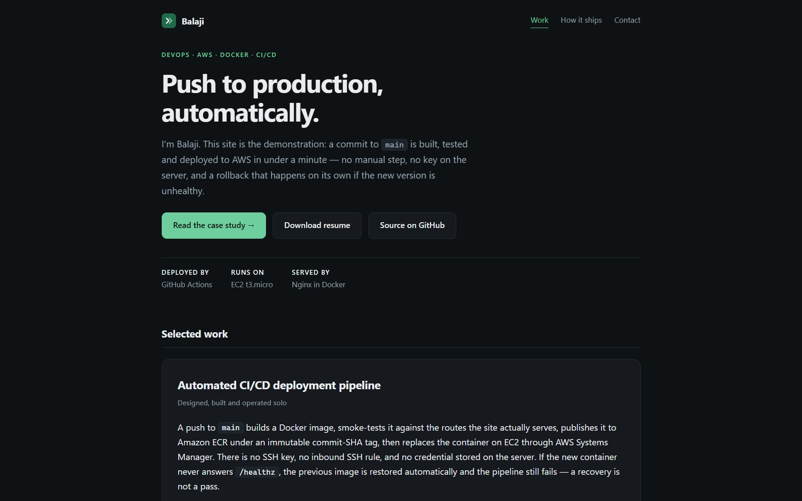
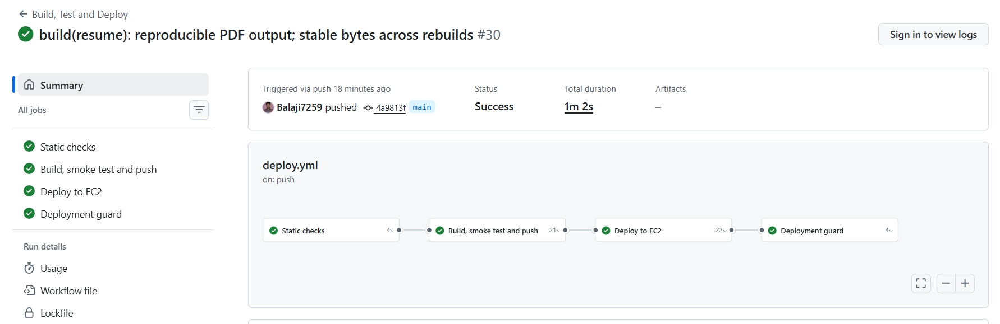
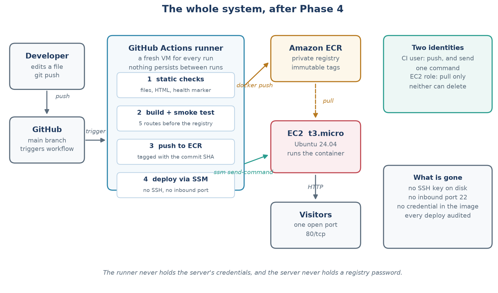
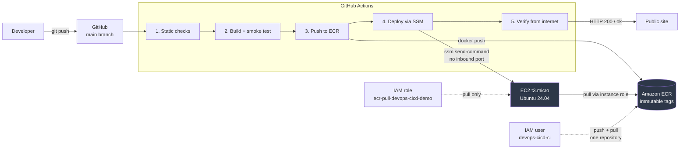
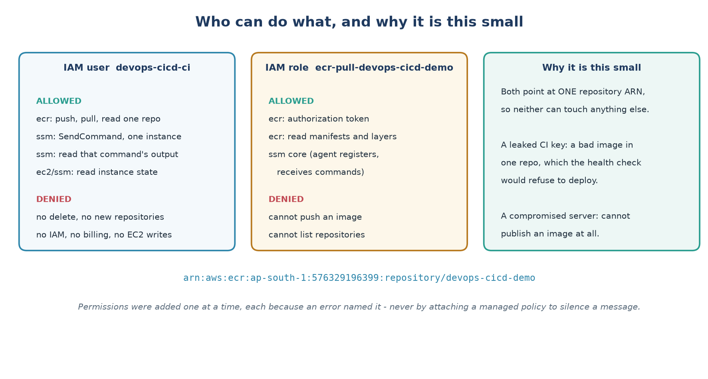
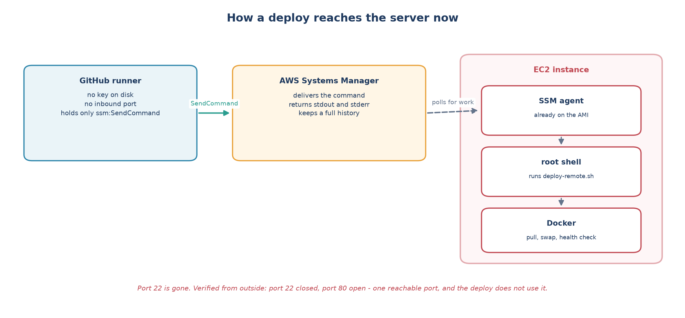
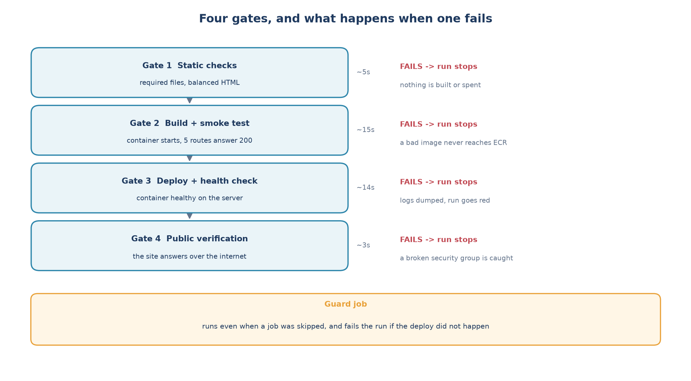
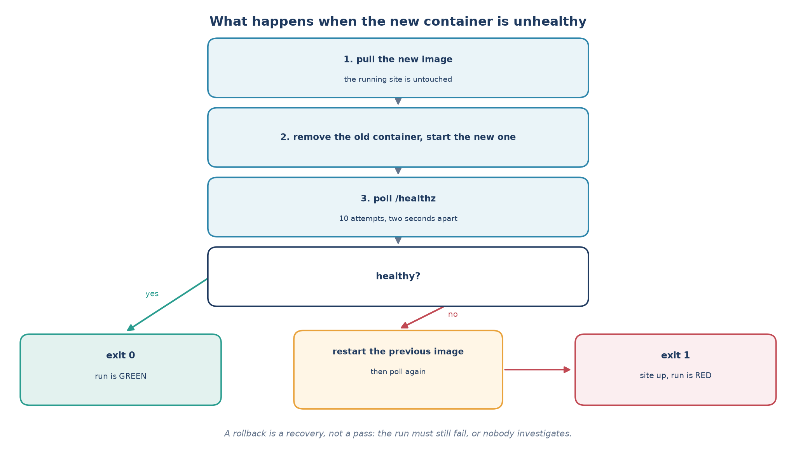

# Automated CI/CD Deployment Pipeline — AWS + Docker

[](https://github.com/Balaji7259/devops-cicd-demo/actions/workflows/deploy.yml)
[](LICENSE)
[](http://15.252.179.238)
[](#security-model)

A push to `main` builds a Docker image, tests it, publishes it to Amazon ECR, and
replaces the container running on EC2. No manual build, no manual deploy, no
credentials on the server.

**Live:** http://15.252.179.238 — health endpoint at `/healthz` returns `ok`.

> The address is a static Elastic IP. It survives stop/start, so the URL above
> stays valid and the `EC2_HOST` secret does not go stale — a dynamic address
> had already invalidated it twice before this was fixed.

The application is a static portfolio site served by Nginx — two HTML documents,
one stylesheet, one SVG, one one-page PDF resume, no build step and no external
requests. It is
deliberately content-only: when the page changes, the deployment worked; when it
doesn't, something in the chain broke and there is exactly one place to look. The
site documents the pipeline that ships it, so the artefact and the case study
cannot drift apart.

---

## What it looks like

| The site it deploys | The run that deploys it |
|---|---|
|  |  |
| A static portfolio served from the container, health-checked at `/healthz` | Four jobs, ~1 minute end to end, with durations from a real run |

---

## Architecture



The runner builds and publishes; the instance only pulls and runs. The deploy
travels through AWS Systems Manager rather than into a port, which is why there
is no SSH key anywhere and no inbound rule to maintain.

The same chain as a graph — useful when reading the workflow, since the jobs map
onto these steps one to one:



Two identities, both scoped to a single ECR repository. The server never holds a
key; it assumes a role. The CI user can push and read images, and nothing else.

| Identity model | How a deploy reaches the server |
|---|---|
|  |  |
| Neither identity can delete anything | No connection is made into the instance |

| The four gates | Failure and rollback |
|---|---|
|  |  |
| Each gate is cheaper than what it protects | A rollback restores service and still fails the run |

Full walkthrough with every command and permission:
**[docs/ARCHITECTURE.md](docs/ARCHITECTURE.md)**. Diagram sources and how to
regenerate them: [docs/diagrams/README.md](docs/diagrams/README.md).

---

## How a deploy works

1. You push to `main`.
2. **Static checks** — required files present, HTML tags balanced, health-endpoint
   contract intact. Fails in ~5s, before any AWS call.
3. **Build and smoke test** — image is built under a *local* tag, started, and
   every route the site depends on is fetched. A broken image never reaches ECR.
4. **Push** — retagged with the **full commit SHA** and pushed to ECR. Tags are
   immutable, so an image can never be silently overwritten.
5. **Deploy** — the deploy script is sent through **AWS Systems Manager**
   (`ssm:SendCommand`) and runs as root on the instance. There is no SSH key and
   no inbound port involved; the instance's own role authenticates it. The
   script pulls from ECR, replaces the container, and checks `/healthz`.
6. **Verify** — health endpoint checked locally, then again **from the public
   internet**, because a local check cannot detect a broken security group.

A `guard` job fails the run if the deploy job did not actually succeed — GitHub
otherwise reports a skipped job as a green run.

**If the new container never becomes healthy, the deploy puts the previous image
back before exiting.** The run still fails — a rollback is a recovery, not a
pass — but the site stays up while somebody reads the log.

Typical end-to-end time: **40–55 seconds**.

---

## Rollback

Rolling back is a dropdown, not an SSH session.

**Actions → Build, Test and Deploy → Run workflow → `image_tag` = `<commit SHA>`**

The run pulls that exact published image, smoke tests it with the same script a
normal deploy uses, and replaces the container. No rebuild, no source revert.

Because images are tagged by commit and never overwritten, every commit that was
ever deployed can be redeployed.

---

## Security model

| Control | Implementation |
|---|---|
| No credentials on EC2 | Instance role `ecr-pull-devops-cicd-demo`; `sts get-caller-identity` returns `assumed-role` |
| Least privilege (server) | Pull actions only, one repository. `DescribeRepositories` is denied — verified |
| Least privilege (CI) | Push + pull, one repository. No delete, no EC2, no IAM |
| No secrets in Git | GitHub encrypted secrets only; `.gitignore` covers keys and env files |
| Deploy channel | `ssm:SendCommand`, scoped to **one instance ARN** and the `AWS-RunShellScript` document. No SSH key exists anywhere |
| Command audit | Every command that runs on the server is recorded in AWS command history with its output |
| Image integrity | ECR tag immutability + scan-on-push |
| Public surface | Port 80 only. No inbound SSH rule; port 22 is not required |

**No OIDC.** The AWS Free plan guardrails block `iam:*Provider*`, so GitHub
cannot federate directly into AWS. The pipeline uses a scoped IAM access key
instead. This is a documented compromise, not an oversight — see
[docs/PHASE-3-GITHUB-ACTIONS.md](docs/PHASE-3-GITHUB-ACTIONS.md).

---

## Repository layout

```
.github/workflows/deploy.yml     the pipeline: four jobs, all gates
.github/workflows/ssm-check.yml  manual read-only probe of SSM connectivity
.github/ISSUE_TEMPLATE/          structured bug and proposal forms
scripts/smoke-test.sh            shared gate: runs and probes an image
scripts/deploy-remote.sh         runs on EC2: pull, swap, health check, roll back
site/                            static site served by Nginx (content only)
Dockerfile                       nginx:1.27-alpine + site files + /healthz
docs/ARCHITECTURE.md             how it works, with diagrams
docs/diagrams/                   published architecture diagrams
docs/PHASE-*.md                  phase-by-phase engineering record
docs/PORTFOLIO-PACK.md           CV bullets, interview Q&A, demo script
build/                           PDF and diagram generators
```

---

## Documentation

| Document | What is in it |
|---|---|
| [docs/ARCHITECTURE.md](docs/ARCHITECTURE.md) | Components, the four gates, the identity model, rollback, invariants, trade-offs |
| [DevOps-CICD-Project-Handbook.pdf](DevOps-CICD-Project-Handbook.pdf) | 51-page handbook: every command, every permission, every failure, with the reasoning |
| [docs/PHASE-1-DAY-1.md](docs/PHASE-1-DAY-1.md) | Local application and first container |
| [docs/PHASE-2-AWS-BASELINE.md](docs/PHASE-2-AWS-BASELINE.md) | Manual deployment on AWS, by hand, on purpose |
| [docs/PHASE-3-GITHUB-ACTIONS.md](docs/PHASE-3-GITHUB-ACTIONS.md) | The pipeline, including the first failures |
| [docs/PHASE-4-HARDENING.md](docs/PHASE-4-HARDENING.md) | Rollback, Systems Manager migration, lifecycle policy |
| [docs/PORTFOLIO-PACK.md](docs/PORTFOLIO-PACK.md) | How to talk about this project in an interview |
| [SECURITY.md](SECURITY.md) | Posture, what is in scope, what is a documented decision |
| [CONTRIBUTING.md](CONTRIBUTING.md) | One rule: behaviour and documentation change together |

The older `docs/CI-CD-Pipeline-Build-Log.pdf` is kept as a historical record. Its
diagrams show the SSH-based design that Phase 4 replaced; the handbook is the
current description.

---

## Run it locally

```bash
docker build -t devops-cicd-demo:v1 .
docker run -d --name devops-demo -p 8080:80 devops-cicd-demo:v1
curl http://localhost:8080/healthz   # -> ok
```

Verify an image the same way the pipeline does:

```bash
bash scripts/smoke-test.sh devops-cicd-demo:v1 8080
```

---

## Failure log

Real incidents from building this, kept because they are the useful part.

| Symptom | Cause | Fix |
|---|---|---|
| `401 Unauthorized` on push | Docker logged in, but the IAM policy granted pull actions only | Added `ecr:InitiateLayerUpload`, `UploadLayerPart`, `CompleteLayerUpload`, `PutImage` |
| All layers uploaded, then `403` on manifest `HEAD` | `docker push` verifies what it wrote; policy lacked `ecr:BatchGetImage` | Added `ecr:BatchGetImage` |
| Rollback run green, nothing deployed | `deploy` used the default `success()`; a skipped `test` job makes it false | Explicit `needs.<job>.result == 'success'` + a `guard` job that fails on a skipped deploy |
| Rollback failed on `docker pull` | CI user could push but not download layers | Added `ecr:GetDownloadUrlForLayer` |

Pattern: every one surfaced only when a *new code path* exercised a permission
the old path never needed. That is why the pipeline has gates before it has
convenience.

---

## Known gaps

- **No failure notification.** A red run is only visible to whoever opens the
  Actions tab. Deliberate for a single-operator project, and the first thing to
  add when a second person depends on it — it must fire on rollback too, because
  a recovered run still means a defective image was published.
- **SSH was removed, not just restricted.** The old port 22 rule is deleted and
  the `EC2_SSH_KEY` secret is gone; the deploy path no longer uses SSH at all.
  GitHub publishes 5,622 IPv4 runner ranges against a 60-rule limit, so
  whitelisting was never possible, and Systems Manager removed the need
  entirely. Verified from outside: `22 open=false`, `80 open=true`.
- **Access key instead of OIDC** — blocked by account plan, see above.
- **Single instance, brief downtime** during container replacement. Not
  zero-downtime; a second instance behind a load balancer would be.
- **A failed deploy costs a few seconds of downtime.** The container is removed
  before the new one starts, so the swap is not atomic. A second instance behind
  a load balancer, or a blue/green swap, would remove even that gap.

---

## Cost

| State | Approx. monthly |
|---|---|
| Running | ~\$12.50 (t3.micro compute, 8 GiB gp3, public IPv4) |
| Stopped | ~\$0.65 (EBS only) |

ECR storage for a handful of images is negligible. Funded by AWS Free plan
credits; the account expires **23 April 2027** unless upgraded.

---

## Licence

MIT — see [LICENSE](LICENSE). The application content in `site/` is a personal
portfolio; the pipeline, scripts and documentation are free to reuse.
