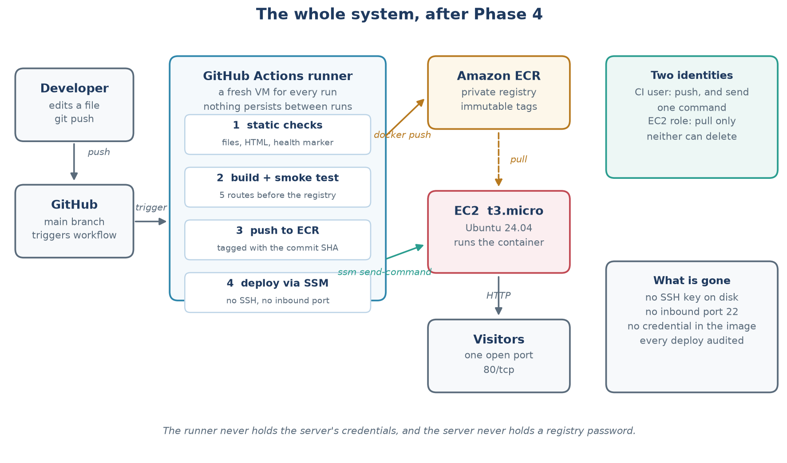
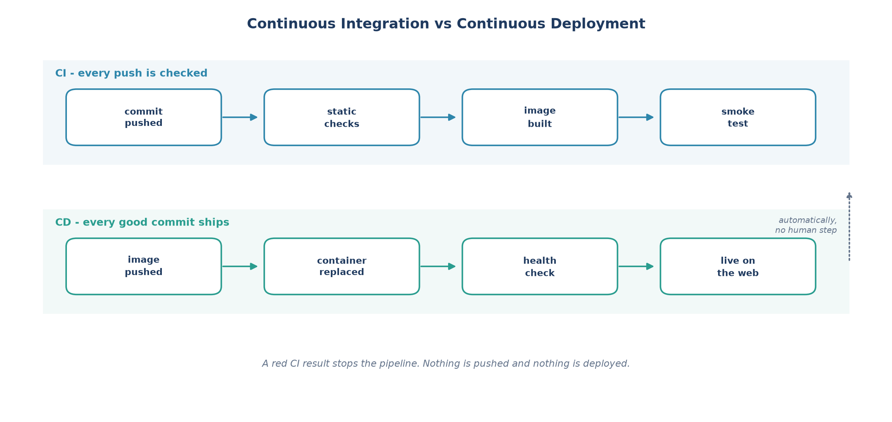
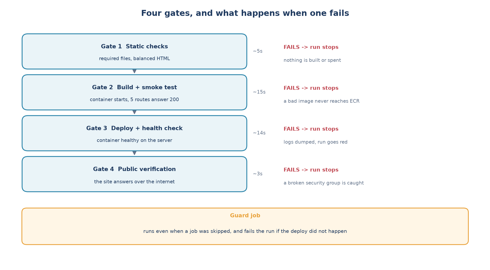
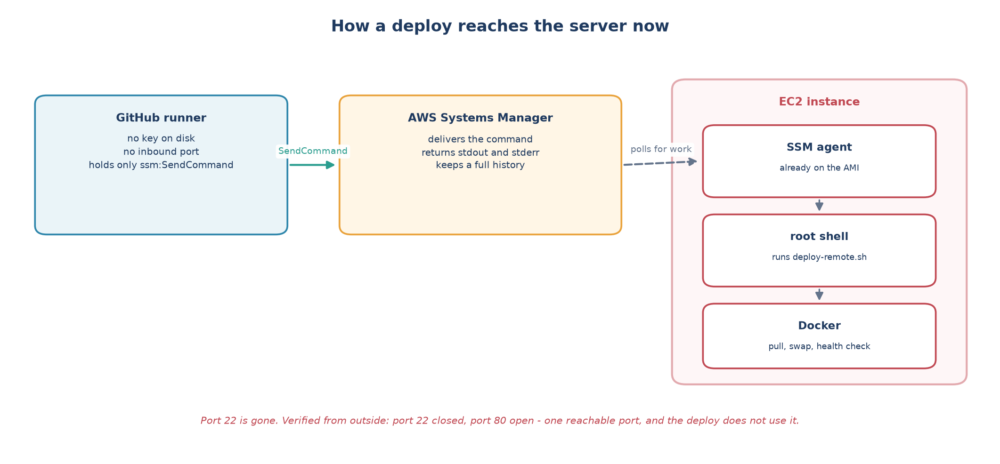
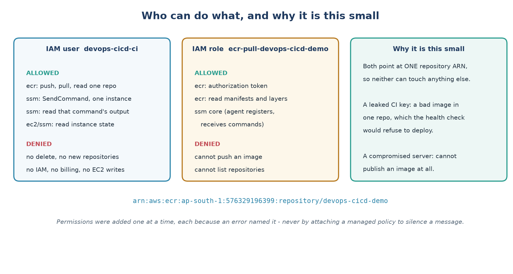
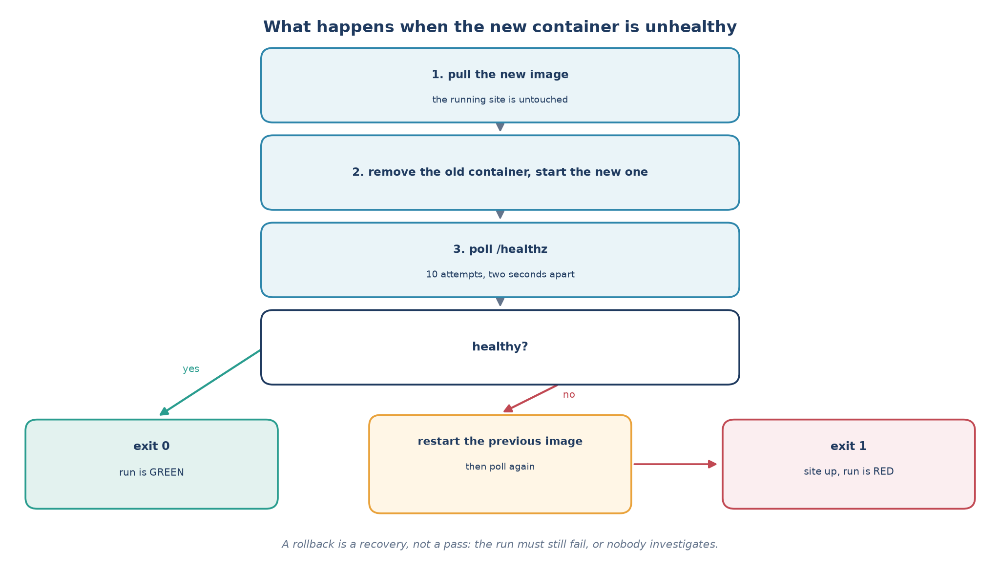

# Architecture

How a commit becomes a running container on AWS, why each piece exists, and which
decisions would have to change if the constraints changed.

Diagrams live in [`diagrams/`](diagrams/) and are regenerated from
`build/gen_arch_diagrams.py` and `build/gen_diagrams.py`.

---

## 1. The system



Four things do the work, and each one has exactly one job:

| Component | Job | Why it is this component |
|---|---|---|
| **GitHub Actions runner** | Build, test, publish, orchestrate | Ephemeral by design — a compromised run cannot affect the next one |
| **Amazon ECR** | Store the artefact | Private, IAM-scoped, same region as the instance, immutable tags |
| **Amazon EC2** | Run one container | Small on purpose: it never builds, only pulls |
| **AWS Systems Manager** | Deliver the deploy command | Removes the need for an inbound port and produces an audit trail |

What is deliberately **absent** matters as much as what is present: no SSH key
anywhere, no credential in the image, no bastion host, no load balancer, no
container orchestrator.

---

## 2. Integration versus deployment



The split is not academic — it decides where a failure is allowed to stop things.

- **CI** ends when the artefact is proven good: files checked, image built,
  routes served from the built image. A red result here means nothing is pushed
  and nothing is deployed.
- **CD** begins when that proven artefact is released: pulled onto the instance,
  container replaced, health confirmed.

This project has real CD and *narrow* CI. There are no unit tests, because the
application is static HTML; the artefact is smoke-tested instead. Claiming
"tested" without that qualifier would be an overclaim.

---

## 3. The four gates



Each gate is cheaper than the thing it protects:

| Gate | Cost | Stops |
|---|---|---|
| Static checks | ~5 s | A typo reaching a two-minute build |
| Build + smoke test | ~15 s | A broken image reaching the registry |
| Deploy + health check | ~14 s | A broken container replacing a working one |
| Public verification | ~3 s | A broken security group or detached address going unnoticed |

A fifth job, `guard`, is not a gate: it runs last and fails the run if the deploy
did not actually execute. It exists because GitHub reports a *skipped* job as a
green run — described in §6.

---

## 4. How the deploy reaches the server



There is no connection from the runner into the instance. The runner calls
`ssm:SendCommand`; Systems Manager stores the command; the agent on the instance
polls outward, picks it up, and runs it as root. The output travels back the same
way and the runner reads it with `get-command-invocation`.

Two consequences that shape the code:

1. **The script has to travel as a string.** `deploy-remote.sh` is gzipped,
   base64-encoded, chunked into 800-character commands, appended to a file in
   `/var/lib/deploy-ci`, then reassembled and executed. A single large command
   does not survive the API's limits.
2. **"The API call succeeded" is not "the deploy succeeded."** The runner must
   read `ResponseCode` and fail on a non-zero exit, or a failed deploy passes
   silently.

Why not SSH: GitHub publishes 5,622 IPv4 runner ranges and a security group
accepts 60 inbound rules, so whitelisting the runner is arithmetically
impossible. The alternative — port 22 open to the world — is a permanent
liability for a deploy that happens a few times a day.

---

## 5. Identity model



Two identities, both pinned to one repository ARN.

| | CI user `devops-cicd-ci` | Instance role `ecr-pull-devops-cicd-demo` |
|---|---|---|
| Holds | A long-lived access key in GitHub Secrets | Nothing — temporary credentials via instance metadata |
| Can | Push/pull one repository; `ssm:SendCommand` on one instance | Pull one repository; register with Systems Manager |
| Cannot | Delete, create repos, touch IAM/EC2, read security groups | Push an image, list repositories |
| If compromised | A bad image in one repository, which the health check would refuse | No ability to publish anything others would run |

**No OIDC.** The account plan's guardrails deny `iam:*Provider*`, so GitHub
cannot federate into AWS. The access key is the fallback, and it is documented
rather than hidden — see [PHASE-3-GITHUB-ACTIONS.md](PHASE-3-GITHUB-ACTIONS.md).

---

## 6. Failure and rollback



`scripts/deploy-remote.sh` runs in four steps, in this order, because the order is
what makes failure survivable:

1. Capture what is running (`docker inspect`) — rollback needs a target.
2. Authenticate and **pull** — a registry problem leaves the running site alone.
3. Remove the old container, start the new one.
4. Poll `/healthz` up to ten times, two seconds apart.

If the new container never answers, the previous image is restored, the health
check is repeated, and **the script still exits 1**. A rollback is a recovery, not
a pass: a run that reports green after recovering teaches everyone to ignore red.

### The false green

The deploy job originally used the default `if: success()`. A rollback run skips
the build job, and a skipped job anywhere in the ancestor chain makes `success()`
false — so the deploy was silently skipped and the run was reported green.

```yaml
deploy:
  needs: build-and-push
  if: always() && needs.build-and-push.result == 'success'
```

`success()` means "nothing failed **and nothing was skipped**". The `guard` job
exists because the explicit condition depends on someone remembering it; a job
named "Deployment guard" is hard to delete by accident.

---

## 7. What talks to what

| From | To | Mechanism | Credential |
|---|---|---|---|
| Developer | GitHub | `git push` over HTTPS | Git credential manager |
| GitHub | AWS | REST APIs | CI user's access key |
| GitHub | EC2 | **Indirect** — via Systems Manager | none |
| EC2 | ECR | `docker pull` | Instance role token (12 h) |
| EC2 | Systems Manager | Outbound poll by the agent | Instance role |
| Visitor | EC2 | HTTP on port 80 | none |

The instance never receives a connection from the runner, and the runner never
stores a credential for the instance. They meet at an API, not at a port.

---

## 8. Invariants

If any of these becomes false, something else in the system is quietly broken:

1. **`/healthz` returns exactly `ok`** — from inside the container, and from the
   public internet. It is created in the `Dockerfile`, not shipped from `site/`,
   so replacing the site content cannot disable it.
2. **Every deployed image is tagged with a full commit SHA** — so "what is
   running?" and "roll back how far?" are lookups, not memories.
3. **Tags are immutable** — a rollback to a tag is a rollback to specific bytes.
4. **No credential exists on the instance** — verification is
   `sts get-caller-identity` returning `assumed-role`, not `user`.
5. **Exactly one port is reachable** — 80. Verified from outside, not assumed.
6. **A run is only green if the deploy actually ran** — enforced by the guard job.

---

## 9. Trade-offs, stated

| Decision | What it buys | What it costs |
|---|---|---|
| Build on the runner, not the server | A 1 GiB instance is enough; no build tools on the host | Cold build every run (~20 s) |
| One instance | Simple, cheap, easy to reason about | A gap of seconds during the container swap. Not zero-downtime |
| Systems Manager over SSH | No key, no inbound port, full audit trail | Slightly more moving parts; a command is not a terminal |
| Scoped access key over OIDC | Works on this account plan | A long-lived secret exists where a good design would have none |
| Immutable SHA tags | Real rollback, real traceability | Tags accumulate; the lifecycle policy has to manage them |
| Rollback exits non-zero | Failures are investigated | A recoverable incident still shows as a failed run |

---

## 10. Where to look when something breaks

| Symptom | First place to look |
|---|---|
| Run red in ~5 s | Static checks — a missing file or unbalanced HTML |
| Run red at smoke test | The image starts but a route 404s, or `/healthz` body is not `ok` |
| Run red at push | An ECR permission; the action named in the error is the one to add |
| Run red at deploy, `InvalidInstanceId` | The instance is stopped — SSM cannot run on a stopped machine |
| Deploy green, verification red | `EC2_HOST` secret vs the instance's actual address |
| Site up but old version | The deploy was skipped: check the `guard` job's result |
| Site down, run red | The rollback also failed; read the remote stderr in the deploy step |

Deeper material: the [project handbook](../DevOps-CICD-Project-Handbook.pdf)
explains every command, identity and failure in 51 pages.
