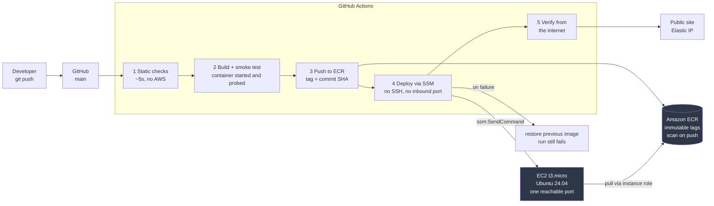

# Portfolio Pack

Outward-facing material for the project: what to put on a CV, what to say in an
interview, and how to demo it in ninety seconds.

Everything here is traceable to something that was actually built and verified.
Where a claim would be inflated — test coverage, zero downtime, multi-environment
— it is not made. That is deliberate: an interviewer who probes a claim you cannot
defend costs you the offer, and the honest version of this project is more
interesting than the padded one.

---

## 1. The one-paragraph summary

> Built an end-to-end CI/CD pipeline that takes a `git push` to a publicly served
> container on AWS in under a minute. Images are built and smoke-tested before
> publishing to Amazon ECR under immutable commit-SHA tags, then deployed to an
> EC2 instance through AWS Systems Manager — no SSH key, no inbound port, no
> credentials on the server. The deploy script health-checks the new container
> and automatically restores the previous image if it fails, while still failing
> the pipeline so the failure is visible.

If one sentence is all there is room for:

> Push-to-production CI/CD on AWS: Docker, ECR, GitHub Actions, and keyless
> deployment via Systems Manager with automatic rollback.

---

## 2. CV bullets

Pick three or four; do not use all of them. Numbers are real and defensible.

- Designed and implemented a CI/CD pipeline (GitHub Actions → Docker → Amazon
  ECR → EC2) delivering commit to production in **40–55 seconds**, with image
  tags bound to the full commit SHA and ECR tag immutability preventing silent
  overwrites.
- Replaced SSH-based deployment with **AWS Systems Manager RunCommand**, removing
  the only service exposed to the internet: the instance now has **one reachable
  port (80)**, **zero credentials on disk**, and every production command recorded
  in AWS command history with stdout and stderr.
- Implemented **automatic rollback**: the deploy script health-checks the new
  container for up to 20 seconds and restores the previous image if it fails —
  proven by deploying a deliberately broken image to the live instance and
  observing recovery with the run still failing red.
- Enforced **least privilege across two identities**: a CI user scoped to
  push/pull on a single ECR repository, and an EC2 instance role with pull-only
  access, verified by direct API probes rather than assumed from policy text.
- Diagnosed a **false-green pipeline** in which a skipped upstream job silently
  skipped the deploy while GitHub reported success; fixed with explicit
  `needs.<job>.result` conditions plus a guard job that fails the run if the
  deploy did not actually execute.
- Reduced AWS spend by sizing to a **t3.micro (1 GiB)** and moving image builds to
  the CI runner, keeping the environment at roughly **\$12.50/month running** and
  **\$0.65/month stopped**.
- Authored a **45-page engineering build log** and phase-by-phase records with
  architecture diagrams, captured failure analysis, and per-claim verification
  evidence.

---

## 3. Interview questions this project invites

Answer in the first person, in this order: what it does, why that way, what broke.

### "Walk me through what happens when you push."

> A workflow triggers on `main`. Four jobs, in order. First static checks: required
> files exist, the HTML parses, the health endpoint contract is intact — it fails in
> about five seconds, before any AWS call. Then the image is built and smoke-tested
> *locally*: container started, five routes fetched, container removed. A broken
> image never reaches the registry. Then it is retagged with the full commit SHA and
> pushed to ECR. Then the deploy job sends a script through Systems Manager, which
> runs as root on the instance: pull, remove the old container, start the new one,
> poll `/healthz` for up to twenty seconds. If it stays unhealthy, the previous
> image is restarted and the job exits non-zero. Finally the site is verified from
> the public internet, and a guard job fails the run if the deploy did not run.

### "Why ECR and not Docker Hub?"

> Private by default, IAM-scoped, same region as the instance so pulls are fast and
> free of egress cost, and scan-on-push. But the reason that mattered most while
> building it: ECR tag immutability. A commit-SHA tag can never be repointed at
> different bytes, so a rollback to a tag is genuinely a rollback to that commit.
> Docker Hub would let the same tag mean something different tomorrow.

### "Why Systems Manager instead of SSH?"

> Because SSH could not be made safe here. GitHub publishes 5,622 IPv4 runner
> address ranges; a security group allows 60 inbound rules. Whitelisting the
> runner was arithmetically impossible, so the alternative was a port open to the
> world with password auth disabled and key-only access — a permanent liability for
> a deploy that happens a few times a day. With RunCommand there is no key to leak,
> no port to scan, and no bastion. The runner holds `ssm:SendCommand` against one
> instance ARN. And I get an audit trail as a side effect: every command and its
> output is stored in AWS.

### "How do you know a deploy actually worked?"

> Three independent checks, because each one can pass while the others fail. The
> health endpoint is polled on the instance right after the swap — that catches a
> container that will not stay up. The image running on the instance is compared to
> the commit SHA — that catches a deploy that silently reused the old image. And the
> endpoint is fetched from the public internet — that catches a broken security
> group or a stale DNS record, which a local check cannot see. I added the third one
> after realising all my earlier checks ran from inside the machine.

### "Tell me about a bug that took you a long time."

> Four consecutive failed deploys, all from one cause: the `--comment` argument on
> the SSM command was 105 characters and the limit is 100. What made it expensive
> was that my diagnostic hid its own message — I built a GitHub error annotation
> from the first line of the AWS error, and the CLI prefixes its error with a blank
> line, which produced an empty annotation that GitHub silently discards. So the
> instrument I built to reveal the failure was invisible. I only found it by
> extracting the workflow step and running it locally, where the error printed
> normally. The lesson I actually took: when a diagnostic shows nothing, suspect the
> diagnostic before the system.

### "A green run that deployed nothing — how?"

> Classic. The deploy job used the default `if: success()`. A rollback run skips the
> build job, and a skipped job anywhere in the ancestor chain makes `success()`
> false — so the deploy was silently skipped and the run still reported green.
> `success()` does not mean "nothing failed upstream", it means "nothing upstream
> was skipped either". I replaced it with an explicit
> `needs.build-and-push.result == 'success'`, and added a guard job that fails
> unless the deploy job actually ran. A green badge that means nothing is worse
> than a red one.

### "Isn't an access key in GitHub secrets a bad practice?"

> Yes. OIDC federation is the correct answer and I could not use it — the account's
> Free plan guardrails block `iam:*Provider*`, so GitHub cannot federate into AWS.
> So the compromise is documented rather than hidden: the key belongs to a user
> whose entire permission set is push and pull on one ECR repository, plus
> `ssm:SendCommand` on one instance. No EC2, no IAM, no delete. If the key leaked,
> the worst case is pushing a bad image to one repository — not controlling the
> account. The upgrade path is a paid plan and OIDC, and it is written down in the
> README rather than quietly omitted.

### "What is not production-ready about this?"

> Four things, and I would rather name them than have them found. Single instance,
> so there is a brief gap while the container is replaced — not zero-downtime; that
> needs a load balancer and a second instance. The application has no unit tests,
> because it is a static site; the artefact is tested instead, and the workflow
> already has the slot for tests when there is code worth testing. No failure
> notification — a red run is only seen by whoever opens the Actions tab. And no
> staging environment: `main` deploys to the only environment there is.

### "Why is the health check `/healthz` rather than checking `/`?"

> Because `/` returning 200 proves Nginx is serving *something*. A dedicated
> endpoint returning a known body proves the container is the one I just deployed
> and its configuration is complete. It is also the contract the smoke test asserts
> before the image is published, so the same signal is checked at build time and at
> runtime — if the marker disappears, the pipeline catches it before ECR, not after
> a customer does.

---

## 4. The ninety-second demo

Rehearse this. Do not improvise it live. Have the tabs already open.

**0:00 — Frame it.** One sentence: "push to `main` builds, tests, publishes and
deploys a container to AWS, and rolls back by itself if the new one is sick."
Show the live URL. It is a static page — say so immediately, and say why: "the
application is deliberately boring so the pipeline is the observable thing."

**0:15 — Make a visible change.** Edit one line of `site/index.html`. `git commit`,
`git push`. Keep the terminal large enough that the audience sees the push, not
your face.

**0:25 — Switch to the Actions tab.** Let it run. Narrate the jobs as they light
up: static checks (fast, no AWS), build and smoke test (a container is started and
probed), push (tagged with this commit), deploy (no SSH — a command is sent through
Systems Manager), verify (from the public internet). Total: under a minute. Refresh
the live page. Change is visible.

**0:50 — Prove the address is not the point.** In the AWS console, open Systems
Manager → Run Command → Command history. Show the deploy command, its exit code,
its output. Say: "this is the audit trail that replaced SSH."

**1:05 — Break it on purpose.** `workflow_dispatch` with the tag of a previous
image, or push a commit that breaks `/healthz`. Let the deploy fail. Show the log:
`ROLLING BACK`, `healthy after 2 attempt(s)`. Refresh the site — still up, previous
version. Point at the red X: "the run still fails, because a rollback is a
recovery, not a pass. If it went green, nobody would investigate."

**1:20 — One number and one omission.** "Forty to fifty seconds end to end, about
twelve dollars a month, one reachable port. What it does not have is a second
instance, so the swap is not zero-downtime — that is the next thing I would build."

Do not exceed ninety seconds by more than thirty. The most common failure in a
portfolio demo is showing everything instead of showing the one thing that is hard.

---

## 5. Architecture, in one page

**The four decisions that shape everything else:**

1. **The runner builds, the server only runs.** A 1 GiB instance cannot compile an
   image; it can pull one in two seconds. This is also why the instance stays
   cheap.
2. **Commits are the version.** No `latest`, no hand-numbered releases. Every
   deployed artefact maps to a SHA, so "what is running?" and "roll back how far?"
   are both queries, not memories.
3. **No long-lived access to the server.** The instance holds a role, not a key;
   the deploy arrives through a control plane, not a port.
4. **Failure must be loud.** Rollback keeps the site up; exiting non-zero keeps the
   failure visible. A recovery that reports success teaches the team to ignore red.

---

## 6. Where the evidence lives

| Claim | Evidence |
|---|---|
| Pipeline works end to end | 27 GitHub Actions runs, four jobs green, latest on commit `2493c8d` |
| Deploy does not use SSH | Deploy step is `aws ssm send-command`; `22 open=false` from an external probe |
| Rollback works | Deliberately unhealthy image deployed to the live instance; previous version restored, run failed red |
| Least privilege is real | Denied calls captured: the CI user cannot describe security groups, lifecycle policies, or read ECR state |
| Running image matches the commit | `docker inspect` on the instance compared image tag to `git HEAD` |
| Cost is small | `t3.micro`, 8 GiB gp3, one public IPv4 — ~\$12.50/month |

Deeper detail: [`../README.md`](../README.md) for the summary,
[`PHASE-4-HARDENING.md`](PHASE-4-HARDENING.md) for the security and failure
analysis, and `CI-CD-Pipeline-Build-Log.pdf` for the full narrative with diagrams.

---

## 7. Honesty ledger

Keep this visible. It is the difference between a portfolio project and a story.

| Not claimed | Why |
|---|---|
| "Zero downtime" | The container is removed before the new one starts. Seconds of gap. |
| "Tested" | No unit tests. The artefact is smoke-tested; the code is static HTML. |
| "OIDC" | Blocked by the account plan. A scoped access key is used and documented. |
| "Production scale" | One instance, one environment, one operator, no autoscaling. |
| "Monitored" | No notifications, no metrics dashboard, no alerting. |

What *is* claimed is narrower and true: a correct, least-privilege, auditable
pipeline that fails loudly and recovers by itself.
